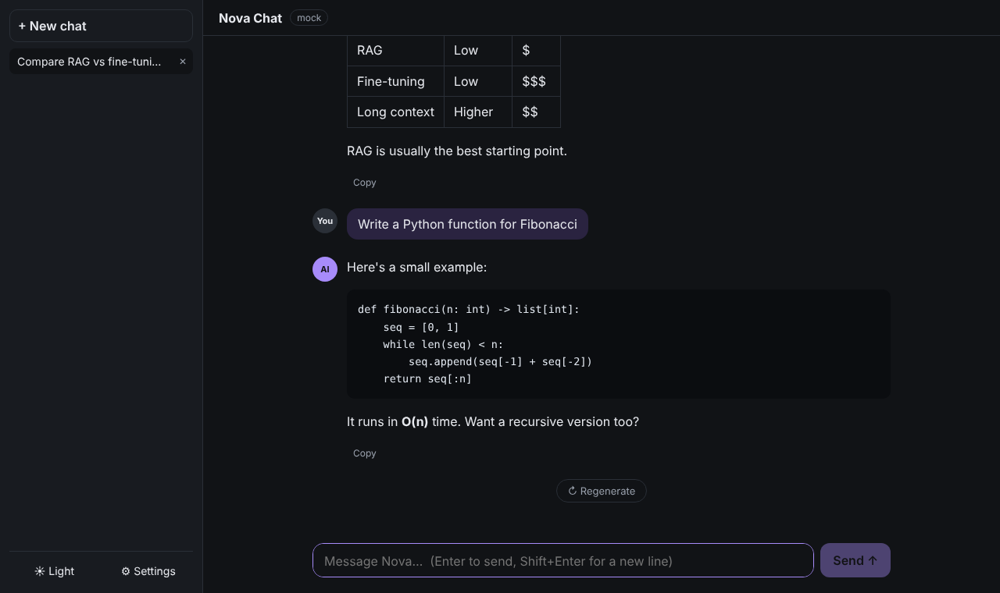
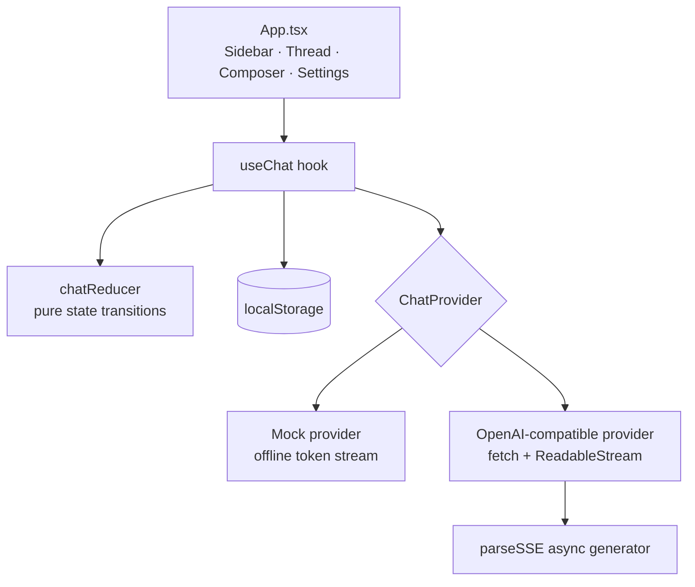

# Nova Chat — Streaming AI Chat UI (frontend)


  

A polished, ChatGPT-style **frontend for LLMs** built with React + TypeScript. It streams tokens in real time
over Server-Sent Events, renders Markdown (code blocks, tables), supports stop / regenerate, keeps multiple
conversations in local storage, and works with **any OpenAI-compatible API** (OpenAI, Ollama, vLLM, LM Studio)
— or a built-in **mock provider** so it demos with zero setup.

> **Focus:** frontend engineering for AI products — streaming UX, state management, accessibility and testability.



## Features

- **Token streaming** with a hand-written SSE parser (handles events split across network chunks and `[DONE]`)
- **Stop generation** via `AbortController`; **Regenerate** last answer
- **Markdown rendering** (GFM tables, code blocks) with a live typing cursor
- **Multiple conversations** — auto-titled, deletable, persisted to `localStorage` (debounced writes during streaming)
- **Provider abstraction** — `ChatProvider` interface with `mock` and `openai-compatible` implementations
- Settings dialog: base URL, model, API key, system prompt; **light/dark theme**
- Smart auto-scroll (pauses when the user scrolls up), auto-growing textarea, Enter / Shift+Enter
- Responsive layout with slide-out sidebar on mobile; ARIA labels on icon buttons and dialog
- **Vitest** unit tests for the SSE parser and the chat reducer; GitHub Actions CI

## Architecture



- **`chatReducer`** holds every state transition (new/select/delete chat, add message, append delta, error, truncate) as a pure function → easy to test.
- **Providers are async generators** yielding text deltas, so the UI code is identical for mock and real models.

## Run it

```bash
npm install
npm run dev        # http://localhost:5173  – works immediately with the mock provider
npm test           # vitest
npm run build
```

To use a real model open **⚙ Settings → OpenAI-compatible API**:

| Backend | Base URL | Model |
|---|---|---|
| OpenAI | `https://api.openai.com/v1` | `gpt-4o-mini` |
| Ollama (local) | `http://localhost:11434/v1` | `llama3.1` |

> The API key is stored only in your browser and is meant for local development. In production, calls should go through a backend (see my [llm-api-service](https://github.com/Soumithroy/llm-api-service)) so keys never reach the client.

## Project structure

```
src/
  App.tsx                    layout, sidebar, thread, auto-scroll
  hooks.ts                   useChat – streaming, abort, regenerate, persistence
  lib/chatReducer.ts         pure state machine (+ tests)
  lib/sse.ts                 SSE stream parser (+ tests)
  lib/storage.ts             localStorage helpers
  providers/mock.ts          offline streaming provider
  providers/openai.ts        OpenAI-compatible streaming provider
  components/                MessageView, Composer, SettingsDialog
```

## Interview talking points

- **Why stream?** Time-to-first-token drives perceived latency; streaming makes a 10s answer feel instant.
- **SSE parsing pitfalls:** TCP chunks don't align with events — buffer until `\n\n`; ignore keep-alives; stop on `[DONE]`.
- **Performance:** memoised message rows so only the streaming message re-renders; debounced persistence.
- **Next steps:** virtualised long threads, syntax highlighting, file/image attachments, conversation search, e2e tests with Playwright.
